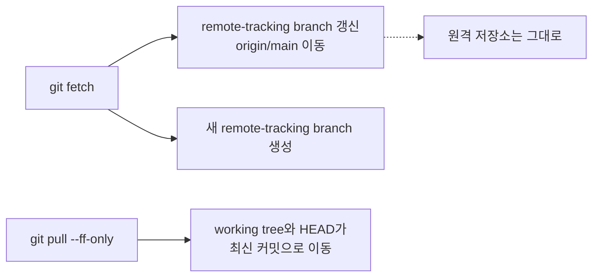
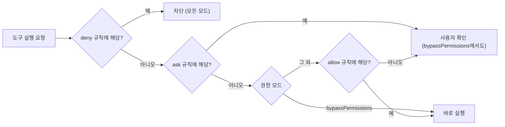

## 문제

AI 코딩 에이전트(Claude Code)에게 막연한 질문을 했더니, 작업 폴더에 있던 다른 사람의 레포 두 개에 `git fetch`와 `git pull --ff-only`를 실행했습니다. 파일 수정, 커밋, push는 없었지만 working tree가 수십 커밋 앞으로 움직였습니다.

권한 확인 없이 도구를 실행하는 모드(`bypassPermissions`)였고, 에이전트가 막연한 요청을 "알아서 진행하라"는 뜻으로 받아들인 것이 원인이었습니다.

## 무엇이 바뀌었는지



| 바뀐 것 | 위치 | 되돌리는 방법 |
|---|---|---|
| HEAD, working tree | 로컬 | `git reset --keep <원래 커밋>` |
| origin/main | 로컬 `.git` | reflog 파일의 old 값으로 `git update-ref` |
| 새로 생긴 원격 추적 브랜치 | 로컬 `.git` | `git update-ref -d` |
| 원격 저장소 | 원격 | 변경 없음 |

## 되돌리기

```bash
# 1. working tree: 원래 커밋으로 (로컬 변경이 있으면 멈추는 --keep)
git reset --keep <원래 커밋>

# 2. remote-tracking branch: fetch 전 값은 reflog 파일의 첫 칸(old sha)에 있음
cut -d' ' -f1,2 .git/logs/refs/remotes/origin/main
git update-ref refs/remotes/origin/main <old sha>

# 3. fetch로 새로 생긴 remote-tracking branch(old sha가 0000…)는 로컬에서만 삭제
git update-ref -d refs/remotes/origin/<새 브랜치>
```

- `git reflog show`는 한 줄만 보여 줘서 이전 값을 알 수 없었습니다. `.git/logs/...` 파일을 직접 열면 old, new 두 값이 모두 있습니다.
- 지우기 전에 해당 기록이 모두 그날 실행된 fetch인지 타임스탬프로 확인했습니다. 원래 있던 기록을 지우지 않기 위해서입니다.
- `--hard` 대신 `--keep`을 쓴 이유는, 혹시 모를 로컬 변경이 있으면 덮어쓰지 않고 멈추게 하기 위해서입니다.

## 막기: ask 규칙

`~/.claude/settings.json`에서 상태를 바꾸는 git 명령을 `ask`로 지정했습니다.

```json
{
  "permissions": {
    "ask": [
      "Bash(git pull *)",
      "Bash(git fetch *)",
      "Bash(git reset *)",
      "Bash(git push *)",
      "Bash(git -C *)"
    ]
  }
}
```

규칙은 아래 순서로 평가됩니다.



공식 문서([permissions](https://code.claude.com/docs/en/permissions), [permission modes](https://code.claude.com/docs/en/permission-modes))에서 확인한 내용입니다.

- `Bash(git pull *)`와 `Bash(git pull:*)`는 같은 의미이고, 끝의 `*`는 인자 없는 `git pull`도 포함합니다.
- 평가 순서는 deny, ask, allow 순이고 먼저 해당하는 규칙이 적용됩니다.
- `bypassPermissions` 모드에서도 ask 규칙은 확인을 요청하고 deny 규칙은 차단합니다. allow 규칙만 의미가 없어집니다.

## 규칙이 걸리는 경우와 안 걸리는 경우

규칙은 명령 문자열을 기준으로 맞춰 봅니다.

| 실행된 명령 | `Bash(git pull *)` | `Bash(git -C *)` |
|---|---|---|
| `git pull` | 걸림 | 안 걸림 |
| `git pull --ff-only` | 걸림 | 안 걸림 |
| `git -C repo pull --ff-only` | 안 걸림 | 걸림 |
| `git -C repo log` | 안 걸림 | 걸림 (읽기 명령도 확인 요청) |

이번에 실행된 형태가 `git -C 경로 pull`이어서 `Bash(git -C *)`를 추가했습니다. 대신 읽기 명령도 확인을 요청하게 됩니다. 문서에서도 이 규칙이 완전한 보안 경계는 아니라고 설명합니다. 확실히 막으려면 샌드박스로 쓰기 가능한 경로를 제한해야 합니다.

## 메모

- 규칙과 함께, 에이전트에게 "질문이 막연하면 먼저 물어볼 것", "다른 사람의 레포는 읽기만 할 것"을 메모리와 CLAUDE.md에 적어 둔 것이 효과가 컸습니다.
- 2026-10-21 기준 Claude Code 문서로 확인한 내용이라 버전에 따라 동작이 달라질 수 있습니다.
