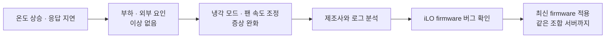

> 2020.05 – 2020.08, Contributor. 관련 프로젝트: [서버 하드웨어 트러블슈팅](/work/hardware-troubleshooting/)

## 요약

특정 제조사 서버 약 200대에서 CPU 온도가 비정상적으로 올라 성능이 떨어지고 응답 시간이 늘었습니다. 부하나 외부 환경 문제가 아닌 것을 먼저 확인했고, 냉각 설정으로 증상을 줄인 뒤 제조사와 로그를 분석해 iLO firmware 버그를 찾았습니다. 최신 firmware로 업데이트한 뒤 온도와 성능이 정상으로 돌아왔습니다.

## 영향

- 대상: 특정 제조사 서버 약 200대
- 증상: CPU 온도 상승, 성능 저하, 응답 지연

## 확인 과정

1. 서버 환경과 부하를 확인하고 성능 모니터링 도구로 살펴봤습니다. 과부하가 원인은 아니었습니다.
2. 서버 설정에서 Enhanced Cooling Mode를 켜고 팬 속도를 바꿔 가며 냉각이 가장 잘 되는 값을 찾았습니다.
3. 제조사와 함께 상세 로그를 분석해 iLO firmware 버그를 확인했습니다.
4. iLO firmware를 최신 버전으로 업데이트해 CPU 온도와 성능을 정상화했습니다.

## 재발 방지

- 같은 모델과 firmware 조합을 쓰는 서버에 업데이트를 미리 적용했습니다.
- 냉각 설정 변경은 임시 조치로 보고, 원인 조치(firmware)와 나눠서 관리했습니다.

## 남긴 점

- 온도 문제라고 해서 냉각 부족이 원인이라고 단정하지 않습니다. 팬을 제어하는 BMC firmware도 함께 확인합니다.
- 서비스 영향을 먼저 줄이고, 원인은 따로 끝까지 확인했습니다.

## GPU 노드에 적용하면

아래는 일반적인 내용입니다.

- GPU는 온도가 올라가면 clock을 스스로 낮춥니다(thermal throttling). 장애가 아니라 성능 저하로 나타나서 놓치기 쉽습니다.
- `nvidia-smi -q -d PERFORMANCE`의 Clocks Throttle Reasons(최근 드라이버는 Clocks Event Reasons)에서 Thermal Slowdown 항목을 확인합니다.
- DCGM으로 GPU 온도와 throttle 사유를 계속 수집하면 특정 랙이나 모델에서만 느린 노드를 찾을 수 있습니다.
- CPU 사례처럼 BMC와 firmware 설정이 팬 제어에 영향을 주므로 firmware 버전도 함께 관리합니다.
