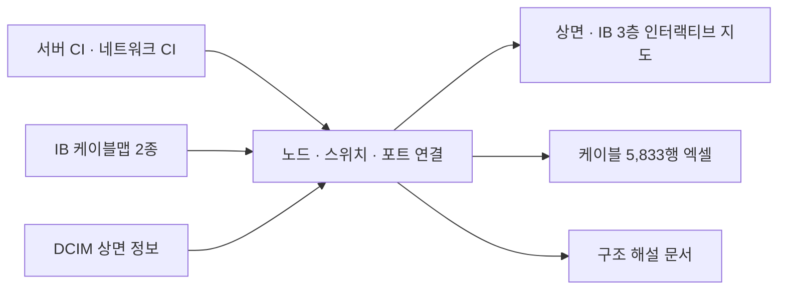
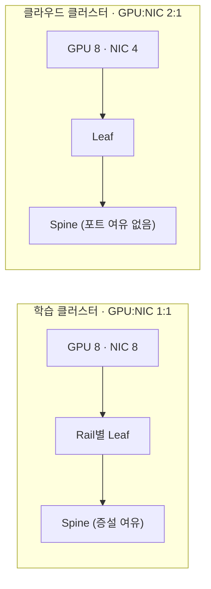

> 직접 설계하거나 테스트한 결과가 아니라, 운영 자료를 보고 분석한 내용입니다.

## 배경

현장에서 운영하는 GPU 클러스터의 설계 문서를 따로 받지 못했습니다. 노드를 옮기고 광모듈을 교체하면서 연결 구조를 정확히 알아야 할 일이 많아, 운영 자료로 구조를 정리해 봤습니다.

## 사용한 자료

- 서버 CI, 네트워크 CI
- InfiniBand 케이블맵 2종
- DCIM

## 정리 방법

1. 서버 CI와 네트워크 CI로 노드와 스위치 목록을 만들었습니다.
2. 케이블맵 두 종을 합쳐 노드 포트와 스위치 포트를 하나씩 연결했습니다.
3. DCIM의 상면 정보로 각 장비의 물리 위치를 붙였습니다.
4. 연결 관계를 보고 GPU당 NIC 수, rail 배치, spine 여유를 판단했습니다.

## 정리한 구조

| 항목 | 200노드급 학습 클러스터 | 250노드급 클라우드 클러스터 |
|---|---|---|
| GPU : NIC | 1 : 1 | 2 : 1 |
| 네트워크 | Rail-optimized, 1:1 non-blocking | Spine 포트 여유 없음 |
| 확장 단위 | SU 32노드, spine 증설 여유 있음 | 해당 없음 |
| 용도 | 학습 | KVM 멀티테넌트 |

두 클러스터 모두 NDR 400G InfiniBand fat-tree, UFM, compute와 storage 네트워크 분리, Kubernetes와 Run:AI를 사용합니다.

정리해 보면 DGX가 아닌 HGX 서버로 NVIDIA SuperPOD 레퍼런스 네트워크 구성을 따른 구조였습니다.

## 만든 자료

- 상면과 InfiniBand 구성을 층별로 볼 수 있는 인터랙티브 지도
- 케이블 5,833행 엑셀(전력 이중화, 광모듈 수량 포함)
- 구조 해설 문서

인수 테스트 성능값(busbw, TFLOPS, 스토리지 대역)은 제가 직접 측정한 값이 아니라서 넣지 않았습니다.

## 운영에 쓴 점

- 학습용 클러스터는 GPU 하나당 NIC 하나, rail 정렬, non-blocking 구성이라 예비 노드도 [원래 자리로 옮겨서](/work/h200-training-cluster/) 복구했습니다.
- 클라우드용 클러스터는 GPU 두 개가 NIC 하나를 함께 쓰고 spine에 여유가 없어, 같은 GPU 세대라도 용도에 따라 네트워크 구성이 다르다는 것을 확인했습니다.
