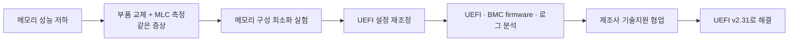
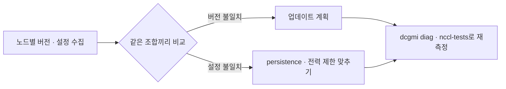

> 2020.04 – 2020.07, Contributor. 관련 프로젝트: [서버 하드웨어 트러블슈팅](/work/hardware-troubleshooting/)

## 요약

특정 제조사 서버 모델에서 CPU P-state 기능과 관련된 메모리 성능 저하가 있었습니다. 부품 교체, 메모리 구성 변경, UEFI 설정 조정을 차례로 해 본 뒤 제조사 기술지원팀과 함께 원인을 좁혔고, UEFI v2.31 firmware로 해결했습니다.

## 영향

- 대상: 특정 제조사의 특정 서버 모델
- 증상: 메모리 성능 저하로 서버 성능과 안정성 하락

## 확인 과정

1. CPU, 메모리, 시스템 보드를 새 부품으로 교체하고 Intel MLC(Memory Latency Checker)로 성능을 다시 측정했습니다.
2. 메모리 구성을 최소로 줄여 가며 CPU와 메모리 사이의 영향을 확인했습니다.
3. UEFI 설정을 초기화한 뒤 IDC 환경에 맞게 다시 맞췄습니다.
4. UEFI와 BMC(IMM) firmware를 최신으로 올리고, 영향받은 서버 로그를 분석해 원인과 영향 범위를 확인했습니다.
5. 제조사 글로벌 기술지원팀과 자료를 주고받으며 해결 시점을 앞당겼습니다.
6. UEFI v2.31 firmware 적용 후 메모리 성능 문제가 해결됐습니다.

## 재발 방지

- 증상이 없던 서버 그룹에도 BMC firmware를 미리 적용했습니다.
- 같은 모델에는 UEFI와 BMC firmware 버전을 맞춰서 관리했습니다.

## 남긴 점

- 증상은 메모리 성능이었지만 원인은 CPU 전력 관리 기능과 firmware였습니다.
- 부품을 바꿔도 같은 증상이면 설정과 firmware를 확인하는 순서로 진행합니다.
- 교체나 업데이트 후에는 같은 도구로 다시 측정해서 확인합니다.

## GPU 클러스터에 적용하면

아래는 일반적인 내용입니다.

GPU도 전력 상태(P-state)와 clock 설정이 성능에 영향을 줍니다. 노드마다 설정이나 버전이 다르면 같은 작업도 노드에 따라 속도가 달라지고, 학습에서는 가장 느린 노드에 전체 속도가 맞춰집니다.

| 확인할 것 | 방법 |
|---|---|
| driver · VBIOS 버전 | `nvidia-smi --query-gpu=driver_version,vbios_version --format=csv` |
| persistence mode | `nvidia-smi -q`의 Persistence Mode 항목, 필요하면 `nvidia-smi -pm 1` |
| 전력 제한과 P-state | `nvidia-smi -q -d POWER,PERFORMANCE` |
| 교체·업데이트 후 확인 | `dcgmi diag`로 진단, `nccl-tests`로 통신 성능 재측정 |

