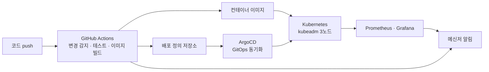

## 배경

- 서비스마다 언어와 배포 방식이 달라 업데이트와 관리가 어려웠고, 새 서비스를 추가하기도 쉽지 않았습니다.
- 배포를 사람이 직접 하다 보니 시간이 오래 걸렸고, 배포 실수로 인한 서비스 중단과 오류가 1년에 10회 이상 있었습니다.

## 배포 흐름

## 한 일

- 개발 스택을 Python, Django, PHP, Spring, React 기준으로 정리하고, PEP8과 Airbnb JavaScript Style Guide로 코드 규칙을 맞췄습니다.
- 환경별로 Dockerfile을 만들어 이미지 빌드를 자동화하고, Alpine Linux 기반 이미지와 빌드 캐시로 이미지 크기와 빌드 시간을 줄였습니다.
- GitHub Actions로 변경 감지, 테스트, 이미지 빌드, Kubernetes 배포까지 이어지는 파이프라인을 만들었습니다.
- kubeadm으로 3노드 Kubernetes 클러스터를 직접 구축하고, ArgoCD로 GitOps 방식의 배포와 워크로드 분리를 적용했습니다.
- Prometheus와 Grafana로 모니터링을 구성하고, GitHub Actions, Kubernetes, Prometheus, Grafana 이벤트를 메신저 배포 채널로 보냈습니다.

## 결과

- push하면 빌드와 테스트를 거쳐 ArgoCD가 클러스터에 반영하도록 배포를 자동화했습니다.
- 배포 절차가 하나로 정리되면서 배포 실수로 인한 장애가 줄었습니다.
- 알림이 배포 채널로 바로 오면서 문제를 알아채고 원인을 찾는 데 걸리던 시간이 몇 시간에서 몇십 분으로 줄었습니다.
