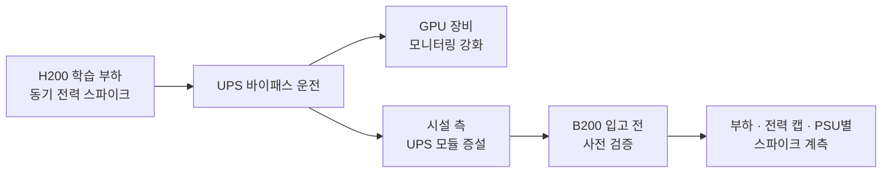
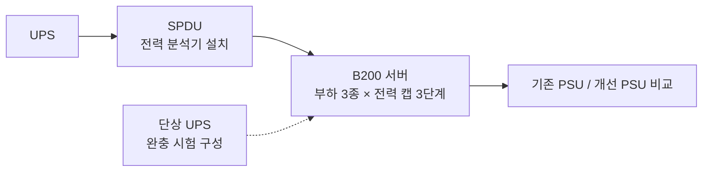

## 흐름

## 배경

학습 작업은 여러 노드의 GPU가 같은 순간에 계산과 통신을 반복합니다. 그래서 GPU 전력이 동시에 오르내리고, 랙과 회로 단위에서 순간 스파이크가 생깁니다.

H200 학습 클러스터에서 이 스파이크 때문에 UPS가 오랫동안 바이패스로 운전됐습니다. 그동안은 순간 정전에 대비가 되지 않았습니다. 이 기간 GPU 장비 모니터링을 강화했고, 이후 시설 쪽에서 UPS 모듈을 증설했습니다.

다음 세대인 B200은 전력 밀도가 더 높아서, 입고 전에 같은 문제를 미리 재현하고 확인하기로 했습니다.

## 시험 구성

두 사이트가 함께 진행한 B200 전력·풍량 사전 검증에서 한 사이트의 현장 계측을 맡았습니다.

| 항목 | 내용 |
|---|---|
| 계측 위치 | SPDU 단 전력 분석기 |
| 시험 조합 | 부하 3종 × GPU 전력 캡 3단계 |
| 추가 시험 | 단상 UPS 완충 시험 |
| 비교 | 기존 PSU와 개선 PSU |
| 담당 | 현장 계측과 PSU 비교 (시험 항목 설계와 종합 보고서는 팀) |

## 확인한 점

- 모든 조합에서 정격을 넘는 순간 스파이크가 나타났습니다.
- 전력 캡을 낮추면 피크 값은 내려가지만, 평상시 대비 스파이크 비율은 거의 그대로였습니다.
- 개선 PSU를 적용하면 회로 피크 전류가 약 절반으로 줄었습니다.

## 검토한 대책

| 대책 | 효과 | 확인 여부 |
|---|---|---|
| GPU 전력 캡 | 피크 값은 낮아지지만 스파이크 비율은 그대로 | 계측으로 확인 |
| 개선 PSU | 회로 피크 전류 약 절반 | 계측으로 확인 |
| 완충 설비 | 순간 스파이크를 UPS 앞에서 흡수 | 단상 UPS 완충 시험 구성 |
| 작업 시작 시점 분산 | 여러 노드가 동시에 부하를 올리는 것을 줄임 | 검토 항목 |

## 정리

- 한 가지 대책으로 해결되지 않아서, PSU, 완충 설비, 작업 운영 방식을 함께 봐야 했습니다.
- 한 세대에서 겪은 문제를 다음 세대 입고 전에 재현해 본 것이 설비 준비에 도움이 됐습니다.
