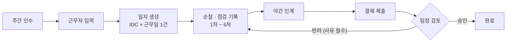
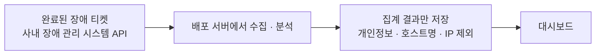
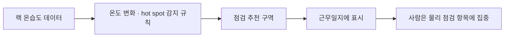

## 근무일지 통합 (2026.07 – 현재)

업무일지, 인수인계, 인프라 점검 일지가 따로 있어서 같은 근무자와 날짜를 세 번 입력하고 결재도 여러 번 받아야 했습니다.

- 기존 일지 데이터를 조사해 근무조(주간, 후근, 야간), 순찰 회차, 인수인계 시점, 결재 규칙을 정리했습니다.
- IDC별로 근무일마다 일지 하나를 만들고, 근무조는 일지 안에서 구분하도록 설계했습니다.
- IDC 14곳을 지원하고, IDC마다 근무 형태(24시간, 주간 전용), 근무조 인원, 구역, 체크리스트, 공지를 관리 화면에서 설정합니다.
- 일지를 만들 때 그날의 설정을 함께 저장해, 설정이 바뀌어도 지난 일지는 그대로 남게 했습니다.
- 권한은 근무 소속, 결재, 관리로 나누고, 여러 IDC를 겸임하는 경우도 처리했습니다.
- 화면 시안을 여러 개 비교해 정한 뒤 구현하고 사내에 시험 배포했습니다.

## SLA 대시보드 (2026.10 – 현재)

장애를 목표 시간 안에 처리하고 있는지, 어디서 늦어지는지를 실제 운영 데이터로 보기 위해 만들었습니다.

| 보는 것 | 내용 |
|---|---|
| 준수율 | 목표 48시간 안 처리 비율, 목표 95% |
| 분포 | IDC, 증상, 장비 제조사·모델별 장애 빈도와 처리 시간 |
| 지연 구간 | 대기 단계와 처리 단계 중 어디서 늦어지는지 |

- 원본 티켓에는 요청자, 담당자, 호스트명, IP가 있어서 밖으로는 집계 결과만 내보냅니다.
- 팀장과 관리자가 필요할 때 잠깐 열어 보는 용도라서 요약 위주로 구성했습니다.

## 점검 방식 개선 (2026.10, 분석과 시제품)

하루 여러 번 사람이 정해진 구역을 도는 인프라 점검 기록을 분석해 보니, 업무 비중은 큰데 결과는 대부분 이상 없음이었습니다.

- 시설 관리 시스템의 랙 온습도 데이터로 온도 변화와 hot spot을 찾는 규칙을 시제품으로 만들었습니다.
- 감지 결과를 바탕으로 일지에 점검이 필요한 구역을 추천하는 화면 시안을 만들었습니다.
- 사람은 물리 점검 항목에 집중하고, 온습도·출입·알람은 자동으로 확인하는 방향으로 진행하고 있습니다.
