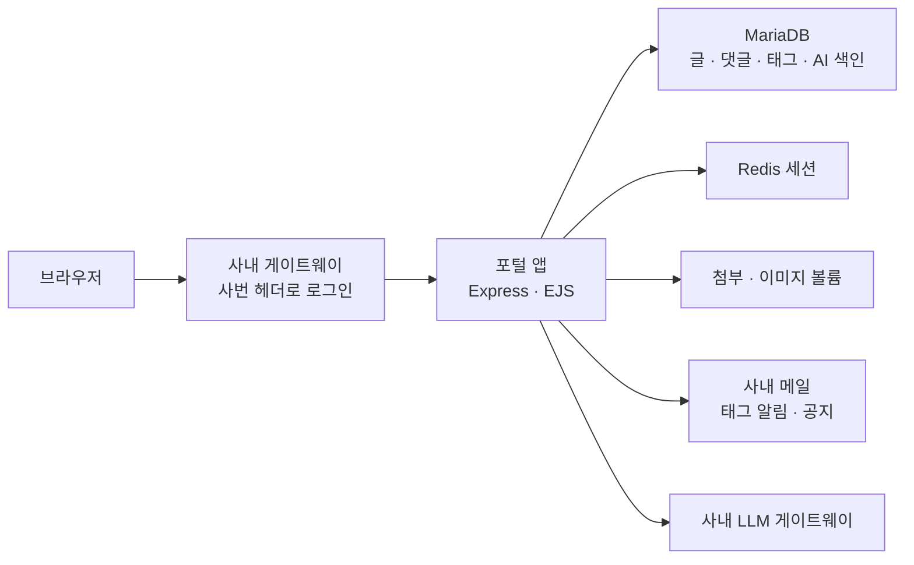
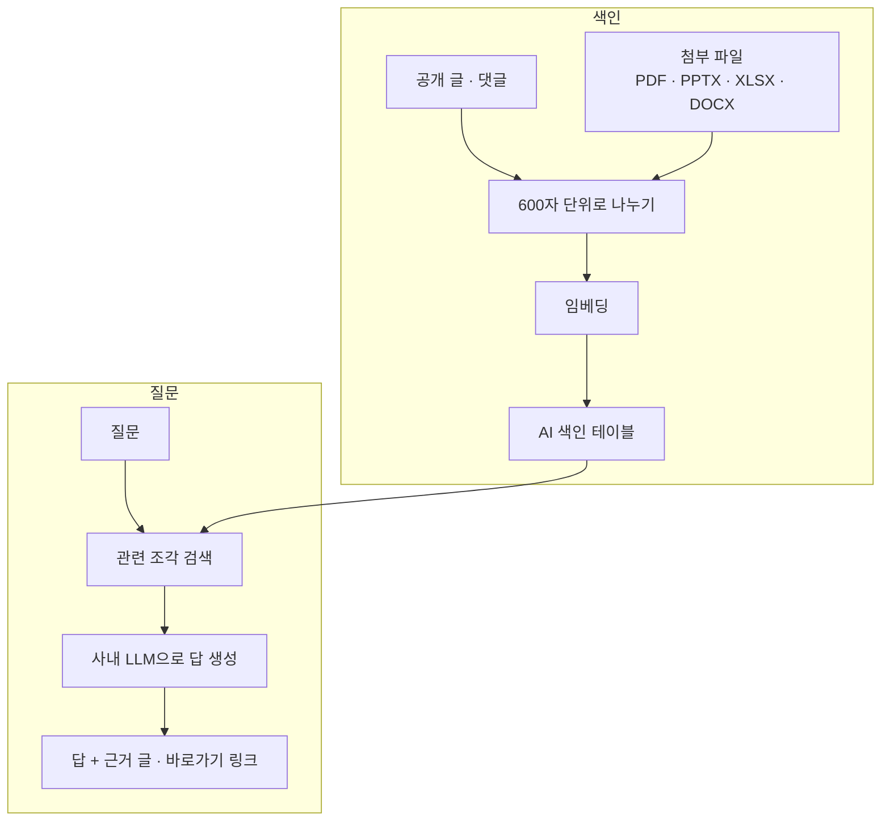

## 배경

공지와 기술 자료, 자주 쓰는 사내 시스템 링크가 여러 곳에 흩어져 있어 필요한 정보를 찾는 데 시간이 걸렸습니다. 자료가 쌓여도 원하는 내용을 다시 찾기가 어려웠습니다.

## 구조

## 기능

| 영역 | 내용 |
|---|---|
| 게시판 | News·Tech 게시판, 공지, 예약 게시, 댓글과 답글, 좋아요, 태그, 북마크 |
| 알림 | 구독한 태그의 새 글 알림 메일, 공지 메일 |
| 홈 | 리마인더 배너, 사내 시스템 바로가기 |
| 검색 | 헤더 검색창에서 바로가기(초성 포함)와 게시글을 함께 검색, 본문 검색어 강조 |
| 에디터 | TipTap으로 직접 구성, 첨부 파일과 본문 이미지 업로드 |
| 관리 | 공지, 배너, 바로가기, 관리자 권한, 이용 통계 |

## AI 도우미 (RAG)

포털에 쌓인 글과 첨부 파일을 근거로 답하는 챗봇입니다.

- 공개된 글 본문, 댓글, 첨부 파일을 600자 단위로 나눠 임베딩해 저장합니다. 첨부 파일은 파일당 앞부분 5만 자까지 색인합니다.
- 질문이 들어오면 관련 조각을 찾아 사내 LLM 게이트웨이로 답을 만들고, 근거가 된 글과 바로가기를 링크로 함께 보여 줍니다.
- 글 목록이나 분류·작성자·연도별 개수 같은 질문은 집계 데이터로 답합니다.
- 포털 데이터에 없는 내용은 답하지 않도록 했습니다.
- 사용자가 좋지 않다고 표시한 답은 저장된 답에서 바로 지우고, 답을 찾지 못한 질문은 관리 화면에서 모아 봅니다.
- 대화 내용은 서버에 저장하지 않고 브라우저 탭에만 둡니다. 통계는 질문 내용 없이 횟수만 남깁니다.

## 운영

- Docker Compose로 앱, MariaDB, Redis를 함께 띄우고, 첨부 파일은 재배포해도 남도록 볼륨에 둡니다.
- 첨부 파일 색인이 컨테이너 메모리 한도를 넘지 않도록 처리 방식을 조정했습니다.
