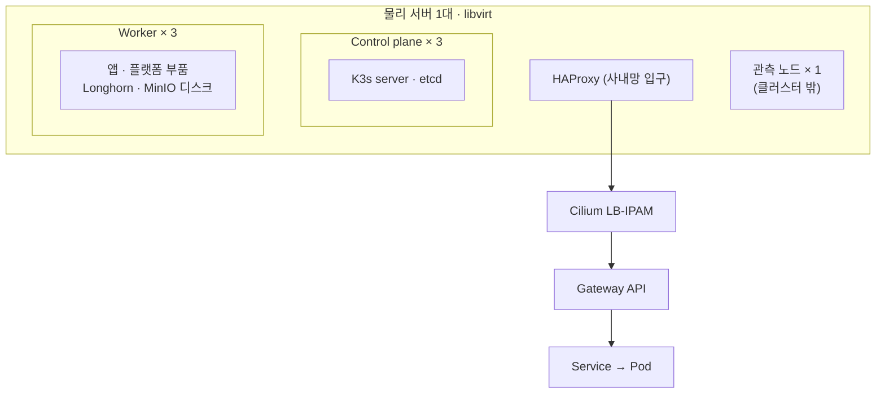
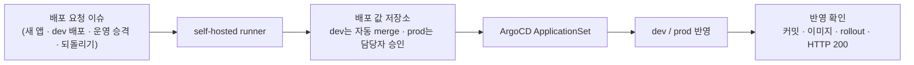

## 배경

컴포넌트를 하나씩 설치해 보는 것만으로는 실제 운영에서 서로 맞물렸을 때 어떻게 동작하는지 알기 어려웠습니다. 장애가 났을 때 관측, 복구, 원인 추적이 실제로 이어지는지, 그리고 그 위에서 모델 추론과 학습을 돌릴 수 있는지 확인하고 싶었습니다.

## 전체 구조

| 층 | 내용 | 도구 |
|---|---|---|
| 기반 | 서버 1대, VM 7대(control plane 3, worker 3, 관측 1), K3s, Cilium | Terraform, Ansible |
| 플랫폼 | ArgoCD가 저장소의 정의를 보고 나머지 부품을 설치(Application 23개) | GitOps |
| 앱 배포 창구 | 이슈로 요청하면 자동화가 배포 값을 만들고 ArgoCD가 dev·prod에 반영 | IssueOps |
| 추론 | vLLM(SmolLM2-135M, CPU), 모델은 MinIO에서 받음 | apps-workload |
| 학습 | train namespace에서 LoRA 학습 Job 실행 | apps-workload |

## 누가 무엇을 바꾸는지

| 대상 | 바꾸는 도구 |
|---|---|
| VM, 네트워크, 디스크 | Terraform |
| 노드 OS, K3s, Cilium, ArgoCD 첫 설치, 비밀값 | Ansible |
| 저장소, 관측, Harbor, Gateway 같은 플랫폼 부품 | ArgoCD (저장소에 파일을 넣고 push) |
| 개발자 앱 | IssueOps |

Cilium은 GitOps 밖에 두었습니다. ArgoCD가 CNI를 잘못 반영하면 클러스터 네트워크가 끊겨 ArgoCD 스스로 복구할 수 없기 때문입니다.

## 저장소 구성

| 층 | 쓰는 곳 | 이유 |
|---|---|---|
| Longhorn (복제 3) | 앱 PVC | 노드가 죽어도 데이터 유지, MinIO로 매일 백업 |
| local-path (노드 디스크) | Prometheus, Tempo 등 관측 작업 공간 | Longhorn에 문제가 생겨도 관측은 계속되어야 함 |
| MinIO | 로그·트레이스·메트릭 장기 보관, 이미지, 백업, 모델, 학습 데이터 | S3 하나로 통일 |

## 앱 배포 창구 (IssueOps)

- 저장소를 플랫폼, 배포 값, 앱 코드로 나누고 권한은 GitHub App 두 개로 분리했습니다.
- 배포 후에는 ArgoCD가 해당 커밋을 실제로 반영했는지, 이미지와 rollout, HTTP 200까지 스크립트로 확인합니다.

## 관측

- 메트릭은 Prometheus에서 Mimir로, 로그는 Alloy에서 Loki로, 트레이스는 OTLP로 Tempo에 모아 Grafana에서 함께 봅니다.
- Alertmanager가 사내 메일로 알림을 보내고, 앱 5xx 에러율 알림과 앱 대시보드를 만들었습니다.

## 검증 방법

- 시작 전 프리플라이트로 서버 상태를 읽기 전용으로 수집하고, 사람이 Go/No-Go를 판단한 결과를 Terraform 입력값으로 썼습니다.
- `terraform apply` 전과 서버 재부팅 후에는 드리프트 검사를 돌려, 커널 업그레이드처럼 바꾸지 않은 요인으로 생기는 문제를 잡았습니다.
- bats로 smoke, full, chaos 단계 검증 스크립트를 만들었습니다.

## 알게 된 점

- 빈 클러스터에서 다시 세울 때 Cilium 설정이 쓰는 ServiceMonitor CRD가 ArgoCD 설치 이후에 생겨 순서 문제가 있었습니다. 다시 세우는 순서도 검증 대상이라는 것을 확인했습니다.
- 다음 단계로 이 환경에서 GPU 없이 진행한 추론·학습 구성을 GPU 클러스터 운영과 연결해 볼 계획입니다.
