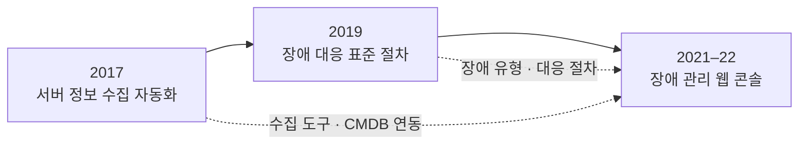
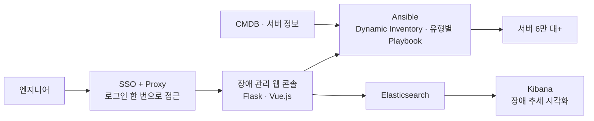

## 진행 순서

| 시기 | 프로젝트 | 바뀐 점 |
|---|---|---|
| 2017.02 – 08 | 서버 정보 수집 자동화 | 수작업 검수를 Ansible 자동 수집으로 전환 |
| 2019.01 – 09 | 장애 대응 표준 절차 수립 | 담당자마다 다르던 대응을 표준 절차와 매뉴얼로 통일 |
| 2021.12 – 2022.10 | 장애 관리 웹 개발 | 서버 직접 접속과 수동 조치를 SSO, Playbook, 웹 콘솔로 대체 |

세 프로젝트 모두 PM으로 진행했습니다. 앞 단계에서 만든 수집 도구와 장애 유형 분류가 뒤 단계의 기반이 됐습니다.

## 2017: 서버 정보 수집 자동화

배경: 서버 정보를 사람이 직접 모으다 보니 대당 수 분씩 걸리고 입력 오류가 잦았습니다. 필요한 정보를 빠르게 모으고 검증하기 어려웠습니다.

- 서버 작업을 기록하고 추적하는 티켓 시스템을 만들고, CMDB에서 서버 정보를 바로 불러오도록 연동해 수동 입력을 줄였습니다.
- dmidecode, MegaRAID 등 제조사와 모델마다 다른 수집 도구를 모듈로 정리해 하나의 명령으로 쓰게 했고, 서버 종류에 따라 필요한 항목만 골라 수집할 수 있게 했습니다.
- Ansible Playbook으로 네트워크상의 서버에 접속해 정보를 병렬로 수집하고 중앙 DB에 저장했습니다.
- 수집 결과는 xlsxwriter로 엑셀 보고서를 만들어 서버 상태와 조치 대상을 바로 볼 수 있게 했습니다.
- 입고, 설치, 변경 작업에서 모든 서버를 같은 기준으로 검수하게 됐습니다.

## 2019: 장애 대응 표준 절차 수립

배경: 대규모 서버 환경에서 장애 대응 방식이 담당자마다 달랐고, 각자 해결하다가 잘못된 명령어를 실행해 추가 장애가 생기기도 했습니다.

- 과거 장애 처리 기록과 로그를 분석해 반복되는 유형과 패턴을 정리했습니다.
- 보안 기준과 컴플라이언스 요구를 충족하는 대응 절차를 만들고, 모든 담당자가 쓸 수 있는 허용 명령어 목록을 정의했습니다.
- 장애 유형별 조치와 안전한 명령어 사용법을 담은 매뉴얼을 실제 장애 상황에서 바로 찾아볼 수 있게 작성했습니다.
- 매뉴얼을 바탕으로 교육과 실습을 진행했습니다.
- 누가 맡아도 같은 절차로 대응하게 되면서 처리 시간과 잘못된 명령으로 생기던 추가 장애가 줄었습니다.

## 2021–22: 장애 관리 웹 개발

배경: 서버 6만 대+에서 하드웨어·OS 장애가 하루 30~40건 발생했습니다. 여러 사람이 서버에 직접 접속해 처리하다 보니 보안 위험이 있었고, 경험이 적은 엔지니어는 처리가 늦었습니다.

- SSO를 proxy 서버와 연동해, 한 번 로그인으로 여러 서비스와 서버 작업을 처리하고 서버 직접 접속은 막았습니다.
- Ansible Dynamic Inventory로 사용자가 입력한 대상의 서버 정보를 실시간으로 모아 작업 대상으로 썼습니다.
- 하드웨어와 OS 장애를 유형별로 나누고, 유형마다 조치를 담은 Ansible Playbook을 만들었습니다.
- Flask와 Vue.js로 웹 콘솔을 만들고, Elasticsearch와 Kibana로 IDC 장애 추세를 시각화했습니다.
- 서버 직접 접속이 거의 없어졌고, 정형화된 장애는 Playbook 실행 한 번으로 수십 초 안에 처리하게 됐습니다. 경험이 적은 엔지니어도 같은 절차로 처리할 수 있었습니다.

## 정리

- 자동화는 한 번에 되지 않았습니다. 표준 절차가 있어야 Playbook으로 옮길 수 있었고, Playbook이 있어야 웹 콘솔로 열 수 있었습니다.
- 이 구조는 GPU 클러스터의 노드 상태 점검, 자동 drain, 조치 흐름과 같은 형태라서 이어서 적용할 수 있다고 봅니다.
